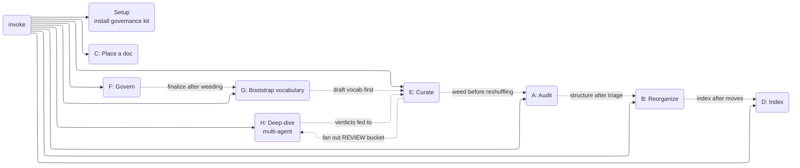

# `doc-librarian` — a docs directory is a library, and libraries need a librarian

**Last Updated: 2026-08-29 21:31**

A Claude Code skill that applies library science to a repository's `docs/`:
taxonomy, Diátaxis classification, YAML cataloging, hub-and-spoke indexes, and a
records-management lifecycle. It audits, triages, reorganizes, indexes, tags and
weeds — and it backs every recommendation with counts rather than taste.

Documentation collections decay in predictable ways: sprawl, duplication,
orphans, stale shelves, no catalog. Those are solved problems in a discipline two
centuries older than software, and this skill is that discipline wired into a git
repository.

**Its central discipline is that it never guesses.** A doc is stale because git
says when it last changed; it is an orphan because nothing links to it, checked
against source and config as well as other docs; it is a near-duplicate because
the TF-IDF cosine between them clears a threshold you set. Every verdict shows
its evidence, nothing is deleted without confirmation, and the destructive
executor is dry-run by default.

This is the **human** reference. [`SKILL.md`](./SKILL.md) is what the agent loads.

## What a run looks like

```mermaid
---
config:
  layout: elk
---
flowchart LR
    audit("Procedure A<br/>audit the collection")
    nlp("analyze-docs.py<br/>optional NLP layer")
    triage("Procedure E<br/>triage-docs.ts")
    report[/"triage report<br/>KEEP / REVIEW / WEED"/]
    deep("Procedure H<br/>one agent per batch")
    verdicts[/"per-doc verdicts<br/>with evidence"/]
    map[/"migration map"/]
    signoff[/"user sign-off"\]
    blast("Procedure B step 0<br/>measure the blast radius")
    reorg("Procedure B<br/>migrate in batches")
    apply("apply-actions.ts<br/>dry-run by default")
    lint("lint-docs.ts<br/>links, tags, frontmatter")

    audit --> triage
    nlp -.->|"near-duplicate clusters"| triage
    triage --> report
    report --> deep
    deep --> verdicts
    verdicts --> map
    report -.->|"skim REVIEW by hand"| map
    map --> signoff
    signoff --> blast
    blast --> reorg
    reorg --> apply
    apply --> lint
    lint -.->|"any new broken link"| reorg
```



## Install

```bash
git clone https://github.com/agentience/agentience-skills.git
cd agentience-skills/skills/doc-librarian
./install.sh --dry-run     # see every path it would touch
./install.sh
```

Then **start a new Claude Code session** — a running one keeps the skill text it
loaded at startup.

`install.sh` symlinks the skill into `~/.claude/skills/`, so `git pull` updates it
in place. `--copy` takes a snapshot instead, `--uninstall` reverses it.

**Installing the skill arms nothing.** It writes nothing to
`~/.claude/settings.json` and changes no repository. The enforcement half — a
linter, and a `PostToolUse` guard that nudges any agent writing a non-conforming
doc — is per-project, and you opt into it from inside a project:

```
/doc-librarian setup
```

which copies the linter to `docs/scripts/lint-docs.ts`, installs and registers the
guard hook, seeds `docs/TAGS.md` if the repo has none, gitignores
`.doc-librarian/`, adds `docs:*` npm scripts, and prints exactly what it touched.
It is idempotent. Two manual steps remain, and it names them: wire
`lint-docs.ts --staged` into your pre-commit hook, and curate `TAGS.md` for your
domain.

### Requirements

| | |
|---|---|
| **git** | required in practice — `git mv` preserves history, `git log` supplies staleness, and referrer counting is a repo-wide grep. The skill runs outside a repo but loses all three signals |
| **Node 22+** | required for the analysis scripts, which run under `node --experimental-strip-types`. `npx tsx` works instead where esbuild is platform-matched |
| **uv**, or python3 + scikit-learn | **optional.** Powers TF-IDF near-duplicate clustering, tag salience and NMF topic themes. Deps are declared PEP 723 inline, so `uv run` provisions them itself |

Without the optional NLP layer everything still runs — near-duplicate detection
falls back to title matching, tag mining to heading frequency. The skill reports
which mode it used. No MCP connectors, no external config, no accounts.

## The procedures

Eight lettered procedures, invoked by describing what you want rather than by
name.

| | What it does |
|---|---|
| **A — Audit** | Evidence-backed assessment: sprawl, MECE violations, depth, loose files, orphans. Counts, never impressions |
| **B — Reorganize** | Staged, non-destructive migration to a target taxonomy. Opens by measuring blast radius, migrates in batches, verifies each |
| **C — Place** | Classify one doc's Diátaxis type, find its one correct folder, give it frontmatter |
| **D — Index** | Hub-and-spoke README indexes so every doc is reachable |
| **E — Curate** | Lifecycle: triage, staleness sweep, deprecate, archive, deduplicate, dispose |
| **F — Govern** | Standards, templates, the linter, the commit-time gate |
| **G — Bootstrap vocabulary** | Derive a controlled tag vocabulary from the corpus's own language, then curate it |
| **H — Deep-dive** | Fan many agents out over the REVIEW bucket, one small batch of *related* docs each, returning per-doc verdicts with evidence |

**They constrain each other.** For a neglected tree the recommended end-to-end
order is **G → E → A → F → B → D** — vocabulary, then weed, then audit, then
govern, then reorganize, then index. Procedure H is an evidence-gathering sidecar
to E's REVIEW bucket. Procedure C runs whenever a single new doc is written.



**Procedures E and H are where the leverage is.** Triage sorts a hundred-odd
documents by signal in seconds; the deep-dive then spends real reading on only
the ones the signal could not decide.

## Examples

```bash
# full cleanup of a neglected docs tree (recommended order)
/doc-librarian              # then follow: G → E → A → F → B → D

# individual procedures
/doc-librarian audit        # Procedure A — evidence-based health check
/doc-librarian curate       # Procedure E — staleness sweep + dedup
/doc-librarian place        # Procedure C — classify and shelve one new doc
/doc-librarian setup        # install the governance kit into this repo
```

### "Our docs are a mess — where do I start?"

Run the recommended order: bootstrap a vocabulary draft (G), weed stale and
duplicate content (E) — fanning out with a deep-dive (H) for the REVIEW bucket if
it is large — audit the survivors (A), finalize governance (F), reorganize into
the target taxonomy (B), then index (D). Each step produces the artifacts the
next one consumes.

### "I'm adding a single new doc"

Procedure C. It classifies the Diátaxis type, picks the folder, adds frontmatter,
names the file and wires it into the index. With the governance hook installed
this fires automatically whenever any agent writes to `docs/**/*.md`.

### "I want enforcement without a full reorg"

`/doc-librarian setup` alone. You get the linter, the authoring-time guard, a
seeded vocabulary and the npm scripts, with no migration.

## Working artifacts

Everything the skill emits lands in **`.doc-librarian/`** at the repo root —
reports, tag drafts, batch briefs, the NLP JSON — and `setup` gitignores it.

This is not tidiness. A report written into `docs/` becomes a document, and the
next scan of `docs/` then appraises the skill's own output alongside the corpus.
Every script defaults out of the audited tree for that reason; `--out` overrides
any single path.

## Gotchas

- **Weed before you reorganize.** Auditing or reshuffling docs you are about to
  discard is wasted work, and dead content lends false authority to a clean new
  structure.
- **Never delete a referenced doc.** Deprecate → archive → much later, dispose.
  Broken inbound links are not acceptable and git history is not an excuse.
- **Never invent a tag.** Tags come from the controlled vocabulary only. If one is
  missing, add it to `TAGS.md` with a definition first.
- **`apply-actions.ts` is dry-run by default.** It writes nothing until `--apply`,
  and refuses to delete a doc with inbound links even under `--confirm-delete`.
- **`example-target-structure.md` is illustrative.** It is a finished audit →
  mapping → sequencing for a fictitious repo. Produce the equivalent for the
  collection at hand and agree it with the team before moving anything.
- **The starter `TAGS.md` is deliberately domain-free.** It names document kinds
  and generic concerns only; the subsystem tags that actually make a corpus
  findable are left empty, because seeding another project's domain vocabulary is
  worse than seeding none. Procedure G derives yours.

## Known limitations

Stated plainly, because each one has bitten a real migration.

- **Reference counting is liveness-blind.** A citation from `specs/completed/`
  weighs exactly as much as one from live source, so a genuinely dead document can
  hold itself out of the WEED bucket on the strength of dead referrers. The
  conservative direction is the safe one — it errs toward human review rather than
  deletion — but do not read a high inbound count as proof of relevance. Weighting
  referrers by liveness is a design question, deliberately not guessed at.
- **`apply-actions.ts` rewrites links inside `docs/` only.** Referrers in source,
  tests and config are *counted* but not *rewritten*; Procedure B step 0 makes you
  measure them and hands you the list to edit yourself. On the corpus this skill
  was hardened against, 56 of 62 moving documents had referrers outside `docs/`,
  and 30 of those were hard — so this is the common case, not the edge.
- **Nothing checks anchors.** `guide.md#configuration` survives a move as a link
  to the right file and the wrong place in it. The linter sees paths, not
  fragments. Procedure B tells you to grep them by hand.
- **A migration is only as honest as its baseline.** Measure broken links *before*
  you start. An absolute count afterwards cannot distinguish breakage you caused
  from breakage you inherited, and the difference decides whether you are done.

## Portability (non-Claude-Code clients)

The five competencies, the procedures, the templates and the scripts are plain
Agent Skills content and run on any skills-compatible client. Only the
**authoring-time enforcement** is Claude Code-specific: `/doc-librarian setup`,
the `PostToolUse(Write)` guard, and its `.claude/settings.json` registration rely
on Claude Code's hook system.

To get the same guarantee elsewhere:

- **Clients with agent hooks (e.g. Kiro)** — reproduce the guard as a native hook
  running `lint-docs.ts --file=<path>` on doc write, nudging the agent through
  Procedure C. The hook script is stdlib Python and portable; only the
  registration mechanism differs.
- **Clients without hooks** — fall back to the client-agnostic commit-time gate:
  `lint-docs.ts --staged` in a pre-commit hook (blocking), plus
  `lint-docs.ts --staleness` as a non-blocking review report. Same rules, one step
  later.

`lint-docs.ts` is the single source of truth for every check, so both paths stay
in sync with the skill.

## What's in the box

| Path | What it is |
|---|---|
| `SKILL.md` | the skill the agent loads: first principles, procedure routing, procedures A–G inline |
| `references/procedure-h-deep-dive.md` | Procedure H in full — batching, waves, the verdict schema |
| `references/principles.md` | the five competencies, in full; read before any non-trivial reorganization |
| `references/frontmatter-schema.md` | required and optional fields, the status lifecycle, vocabulary rules |
| `references/example-target-structure.md` | a worked audit → mapping → sequencing for a fictitious repo |
| `scripts/triage-docs.ts` | non-destructive scorer — buckets every doc KEEP / REVIEW / WEED with evidence |
| `scripts/analyze-docs.py` | optional scikit-learn layer: near-duplicate clusters, tag salience, NMF topics |
| `scripts/plan-review-batches.ts` | packs the REVIEW bucket into similarity-first batches, one brief per agent |
| `scripts/aggregate-results.ts` | rolls the agents' verdicts up into coverage and action lists |
| `scripts/apply-actions.ts` | executes the mechanical verdicts — dry-run by default, staged per batch |
| `scripts/suggest-tags.ts` | mines a draft controlled vocabulary from the corpus |
| `scripts/lint-docs.ts` | the single source of truth for every check; copied into the target repo |
| `scripts/setup.sh` | installs the governance kit into a project |
| `hooks/docs_structure_guard.py` | `PostToolUse(Write)` nudge when an agent writes a non-conforming doc |
| `templates/*.md` | one starter per Diátaxis type, plus an ADR |
| `TAGS.md` | starter vocabulary — deliberately domain-free; Procedure G derives the real one |
| `RESEARCH-REPORT.md` | the library-science sources the procedures are built on, and a worked audit |
| `diagrams/*.mmd` | mermaid sources for the diagrams above |
| `install.sh` | opt-in installer / uninstaller |
| `START-HERE.md` | self-contained bootstrap doc — point an agent at its raw URL and it installs and drives the skill from scratch |

## Where this copy comes from

**There is a second copy, and you need to know about it before you edit either.**
The skill also lives at `~/.claude/skills/doc-librarian/`, tracked in a separate
private dotfiles repository. That is the copy Claude Code actually loads on the
author's machine; this one is what everyone else installs.

Two live copies of a skill diverge silently — there is one `version` field and no
mechanism that compares behaviour — so `scripts/sync-doc-librarian.sh` in this repo
compares them for you:

```bash
./scripts/sync-doc-librarian.sh --check    # report drift, exit 1 if any
./scripts/sync-doc-librarian.sh --push     # this repo  -> installed copy
./scripts/sync-doc-librarian.sh --pull     # installed copy -> this repo
```

It syncs the behavioural surface only — `SKILL.md`, `references/`, `scripts/`,
`hooks/`, `templates/`, `TAGS.md`. `README.md`, `START-HERE.md`, `install.sh` and
`diagrams/` are this copy's own publishing material and are deliberately left
alone. It never commits, in either direction.

`--pull` is a first-class direction, not a rescue hatch: most of this skill's
fixes were authored by editing the installed copy *while using it*, which is how
the two drifted in the first place.

Treat **this** directory as canonical for anything published: the raw URLs in
`START-HERE.md` resolve here. If you would rather have one copy than two, let
`install.sh` symlink `~/.claude/skills/` at this checkout — the sync script
detects that case and exits cleanly, because there is then nothing to sync.

The skill was developed against a real 9-package TypeScript monorepo and then
hardened by running it on that repo's own 136-document corpus. That exercise
surfaced 17 defects and design gaps, 13 of which are fixed here. The four that
remain are the *Known limitations* above, and they are open on purpose: three are
design questions that would have to be guessed at, and the fourth is a substantial
piece of engineering. A skill that quietly did the wrong thing in those places
would be worse than one that names them.

## License

The skill declares `license: Apache-2.0` in `SKILL.md`'s frontmatter, which is
what governs this directory. The repository around it is MIT — see
[LICENSE](../../LICENSE).
