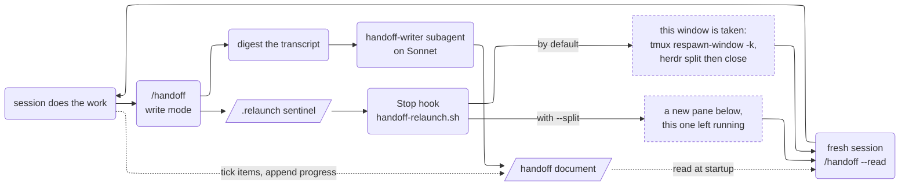
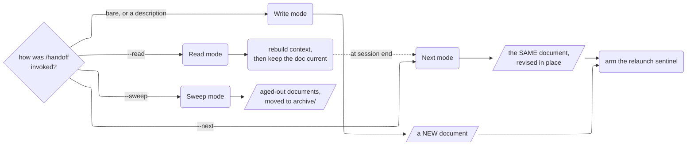

# `/handoff` — a document, not a transcript, carries the work forward

**Last Updated: 2026-08-28 14:20**

A Claude Code skill that ends a session by writing a handoff document, and starts
the next one by reading it. In a terminal multiplexer — tmux or
[Herdr](https://github.com/agentience/herdr) — it closes the loop: the session
that writes the document arms a `Stop` hook which replaces its own window with a
fresh `claude` already reading that document, so the next session is waiting,
primed, whenever you come back. With `--split` the successor opens in a new pane
below instead, and the session that wrote the document keeps its own.

The document is the unit of continuity. Not the transcript, not your memory of
what you were doing, not a TodoWrite list that dies with the session.



## Install

```bash
git clone https://github.com/agentience/agentience-skills.git
cd agentience-skills/skills/handoff
./install.sh --dry-run     # see every path it would touch
./install.sh
```

Then **start a new Claude Code session** — a running one keeps the skill text it
loaded at startup.

| Flag | Effect |
|---|---|
| *(none)* | symlink the skill, install the writer agent, register the `Stop` hook |
| `--copy` | copy the skill instead of symlinking it (default symlink means `git pull` updates it in place) |
| `--no-hook` | skip the tmux relaunch entirely |
| `--dry-run` | print what would happen, change nothing |
| `--uninstall` | reverse everything it installed |

It backs up `settings.json` before editing, matches on the command string so
re-running never double-registers, and removes only its own entry on uninstall.

### Requirements

| | Why | If missing |
|---|---|---|
| **Claude Code 2.1.69+** | the skill finds its bundled `digest-transcript.ts` through `${CLAUDE_SKILL_DIR}`, added in that release | the variable isn't substituted and the digest fails *silently*, degrading write mode to a brief-only document that looks identical to a well-sourced one |
| **Node 18+** | the digest runs through `npx tsx` | write mode falls back to `--inline` and says so |
| **tmux or Herdr** | only for the relaunch | install with `--no-hook`; everything else works |
| **jq or python3** | only for editing `settings.json` during install | `install.sh` prints the JSON for you to paste |

`install.sh` checks all of these and tells you which case you're in.

**If you use nvm, fnm, asdf or volta, read this.** Those put `node` on your PATH
from an *interactive* shell rc, and the shell Claude Code's Bash tool spawns is
not interactive — so `node --version` working in your terminal does not mean the
skill can find it. `scripts/digest.sh` exists for exactly this: it probes the
usual version-manager layouts before giving up. Check with:

```bash
./scripts/digest.sh --probe
```

## The four modes



**Write mode** (`/handoff`) digests the session transcript — main loop plus every
subagent sidecar — to about 1.5% of its raw size, then hands that digest plus a
salience brief to a Sonnet subagent that drafts the document. Delegating matters
more than it looks: write mode runs at the *end* of a long session, where every
main-loop turn re-sends the full accumulated context. The digest also survives
compaction, so it still holds the early dead ends your context window no longer
does.

**Sweep mode** (`/handoff --sweep`) is the housekeeping one. `.claude/handoffs/`
accumulates a document per session, and most finish their working life long
before anyone deletes them; sweep archives everything whose `**Last Updated**`
line is 15 days or older into `.claude/handoffs/archive/`, labelled *resolved* or
*stale* depending on whether any work items were left unticked — and rewrites
every reference to the moved path across your journal and other handoffs, so old
links keep resolving. `--dry-run` first; it is manual by design.

**Read mode** (`/handoff --read`) rebuilds context from a document and — this is
the part that makes the system work — takes ownership of it. The document you
just read is now your working record, not the previous session's artifact. You
tick items as you finish them, add ones you discover, and append to the progress
log as you go, not at the end, because the session may not get an end.

**Next mode** (`/handoff --next`) refreshes the document you resumed from instead
of writing a second one describing the same work. A maintained document is
current as of the last time you touched it, not as of now — and the trailing
stretch of a session is exactly the part the next session needs. When that
trailing stretch is empty, though — you updated the document and the very next
thing that happened was `--next` — it relaunches on the document as it stands
rather than spending a digest and a subagent to conclude the file was already
right.

## What the document carries

Beyond the narrative: a `## Work items` checklist that a reader can tick, a dated
`## Progress log` a later session appends to rather than quietly rewriting, a
`## Decisions needed` section for real forks the user owes an answer on, and a
`## Window slug` — a 2–4 word tmux window title naming *the work the next session
picks up*, which read mode applies to its own window.

The document also carries its own update instruction, so it keeps working when
it's pasted into a fresh session or opened by a human rather than loaded through
this skill.

There is an optional `## AMQ coordination` contract for sessions that talk to
other agents over [AMQ](https://github.com/agentience/amq). Skip it if you don't
use AMQ — nothing else depends on it, and the section omits itself when there was
no traffic. The shape is the reusable part: which channel, which peers, what is
owed, and above all *what was watching the inbox*, which is the thing a
transcript makes nearly invisible.

## The multiplexer half is optional

The relaunch — sentinel, `Stop` hook, the window swap — is the only part that
needs a multiplexer. Without one the hook is absent or exits immediately, the
sentinel is a stray dotfile, and nothing else changes. Install with `--no-hook`
and you keep the document, the living-record discipline, `--read`, `--next` and
`--sweep`, which is most of the value and works in any harness.

Two backends, picked at run time and deliberately indistinguishable in effect:
**tmux**, where the successor takes this window through `respawn-window -k`, and
**Herdr**, which has no in-place respawn and so splits the current tab and closes
the old pane from the new one — which keeps the tab's position and label, where
opening a tab would have appended one at the end.

Three possible fates for the window you are sitting in, most protective first:

| | What happens |
|---|---|
| `--no-relaunch` | Nothing is armed. The document is written and you stay where you are — the right call when the handoff is a checkpoint rather than an exit. |
| `--split` | The successor opens in a **new pane below** and this pane keeps running, with its scrollback and its ability to answer one more question. Outside tmux and Herdr it does nothing at all rather than opening a window elsewhere. |
| *(default)* | This window becomes the successor. |

## Environment overrides

`handoff-relaunch.sh` reads five variables, all optional:

| Variable | Default | Purpose |
|---|---|---|
| `HANDOFF_RELAUNCH_DISABLE` | unset | Non-empty disables the hook entirely. |
| `HANDOFF_COMMAND` | `/handoff` | The slash command the new session runs. Set it if something else on the machine also answers to `handoff`; a plugin namespace alone does not need it, since the bare name still resolves. |
| `HANDOFF_CLAUDE_ARGS` | `--dangerously-skip-permissions` | Args passed to `claude` before the prompt. Empty string passes none. |
| `HANDOFF_HERDR_MODE` | `replace` | Herdr only. `beside` keeps the old pane instead of closing it — the ambient form of what `--split` does per invocation. |
| `HANDOFF_HERDR_DIRECTION` | `right` | Herdr only. Which way the replacement pane is split off. `--split` overrides both of these with `down` + `beside`. |

That default is load-bearing rather than a preference: the relaunched session
runs `--read` immediately in a window nobody is watching, and a permission prompt
there is never answered — it blocks until you walk up hours later and find a
session that never started. If you'd rather the window wait for you, set
`HANDOFF_CLAUDE_ARGS` to the empty string.

**One hazard worth knowing:** a child `claude` inherits `$TMUX_PANE` from its
parent, so an unguarded nested session can respawn its *parent's* window. The
hook bails out when `AGENTIC_ENGINE_SESSION` is set; if you run an orchestrator
that spawns Claude sessions, have it export `HANDOFF_RELAUNCH_DISABLE`.

## What's in the box

| Path | What it is |
|---|---|
| `SKILL.md` | the router: which mode an invocation selects, and nothing else |
| `modes/{write,next,read,sweep}.md` | one file per mode, read on demand |
| `references/*.md` | the document contract, window slug, AMQ, relaunch mechanism, digest provenance — loaded from a mode at the point it needs them |
| `agents/handoff-writer.md` | the writer subagent, in write and revise modes |
| `scripts/digest.sh` | resolves node, then runs the digest — handles nvm/fnm/asdf/volta |
| `scripts/digest-transcript.ts` | transcript → timestamped markdown timeline |
| `scripts/sweep-handoffs.ts` | the archiver behind `--sweep` |
| `hooks/handoff-relaunch.sh` | the `Stop` hook that consumes the sentinel |
| `hooks/tmux-rename.sh` | explicit window rename, used by read mode's window slug |
| `diagrams/*.mmd` | mermaid sources for the diagrams above |
| `install.sh` | opt-in installer / uninstaller |

**Why it is split up.** The skill text used to be one file that was loaded whole
whatever you typed, so a `--sweep` paid for read mode's rules and a `--read` paid
for write mode's. `SKILL.md` is now a router of about 7 KB; a `--read` session
loads it plus one mode file, and the references only when a mode says to.

`tmux-rename.sh` is left in place on uninstall — it's useful on its own, and you
may have been using it before this skill. It resolves its target from
`$TMUX_PANE` rather than trusting a bare `tmux rename-window`, which with no `-t`
targets the most-recently-active session server-wide and will happily rename a
window belonging to a different project.

## Where this copy comes from

The same skill ships inside the [`agentic` Claude Code
plugin](https://github.com/agentience/claude-plugin-agentic) as
`/agentic:handoff`, and **that copy is the canonical one**. This directory is a
mirror of it, pushed by `scripts/sync-handoff-skill.sh` in that repo, which also
has a `--check` mode that reports any drift between the two.

Two consequences worth knowing before you edit anything here:

- **Edits made in this directory will be overwritten by the next push.** Make
  them in the plugin repo, or expect to hand them back.
- **The skill text is free of plugin-only paths on purpose.** Scripts are reached
  through `${CLAUDE_SKILL_DIR}`, which resolves in both installs, and the
  `/agentic:` namespace appears only in SKILL.md's *Invocation name* section,
  which names both forms. That is what lets the mirror be a plain copy with no
  rewriting step.

Everything outside the skill — this README, `diagrams/`, and the `install.sh`
flags that only make sense without a plugin — is this copy's own.

## License

MIT — see [LICENSE](../../LICENSE).
