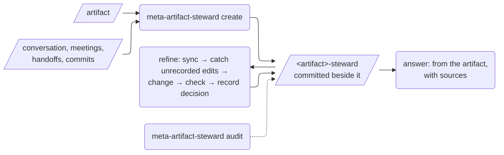

# `meta-artifact-steward`: keep the why with the work

**Last Updated: 2026-10-28 12:25**

A Claude Code skill that gives an artifact a **steward**: a small project skill, committed next to the artifact, that holds the context and the decisions that got the artifact to where it is.

Any artifact that more than one person, or more than one session, will keep refining qualifies: a pricing workbook, a proposal, a contract draft, a deck, a spec, a diagram. The steward answers questions about the artifact with sources. It also changes the artifact through a process that records each new decision: who made it, when, and why.

## Why

An artifact is the visible half of the work. The other half is *why it is the way it is*: what it is built from, which options were weighed, which assumptions nobody has reviewed, what is still open. That half lives in the session that produced the artifact, and is lost when the session ends.

The next person to touch the artifact then does one of three things:
- re-derives the reasoning, which is slow
- guesses it, which is wrong
- quietly reverses a decision someone made for a good reason, which is worst

A steward keeps that half in the repo, versioned with the artifact, where everyone who pulls gets the same understanding.

**The type of artifact isn't the point.** A workbook and a document get the same steward. The only difference is whether the artifact has rules a script can check, and if it does, the steward carries that check too.

## What a steward looks like

```
<repo>/.claude/skills/<artifact>-steward/
├── SKILL.md         answer and refine procedures for this artifact
├── context.md       purpose, sources, structure, assumptions (sourced), conventions, traps
├── decisions.md     D1, D2… (who, when, source, why, where) + open questions
├── steward.json       artifacts, editing mode (merge | exclusive), collaborators, visibility, consumers
├── state.json       fingerprints at the last recorded change
└── scripts/
    ├── state.py     --check / --record: catches edits made without a recorded decision
    └── check.*      optional: the artifact's own rules
```

The steward keeps the record and runs the process. **People make the decisions**, and every decision names who made it.

## How it works



**Create** pins down the artifact: its source of truth, editing mode, collaborators, visibility and downstream consumers. It harvests context and decisions from the conversation and the project's records, with a source for every decision. It then writes the steward, proves it (including that any check script fails on a broken copy), and records a baseline.

**Audit** reports, for each steward in a repo:
- artifacts changed without a recorded decision
- steward files that aren't committed
- open questions left to age
- hand-made skills that should be adopted

**Adopt** brings a steward that was written by hand under the contract, keeping its content.

The full contract is in [references/steward-contract.md](references/steward-contract.md), and the method for finding and citing decisions is in [references/harvesting.md](references/harvesting.md).

## Install

```bash
cd agentience-skills/skills/meta-artifact-steward
./install.sh --dry-run
./install.sh
```

The scripts need `python3` and `git`, and use only the standard library. Each steward you create states any further tools its own artifact needs.
